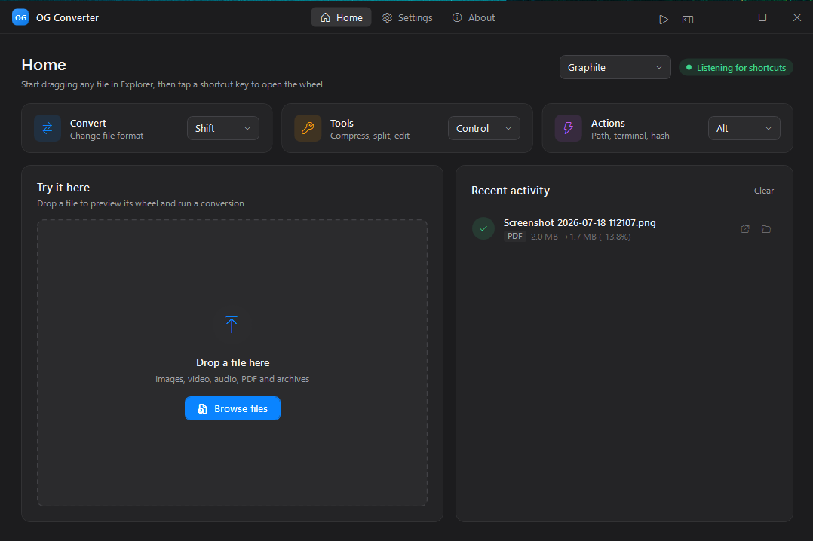
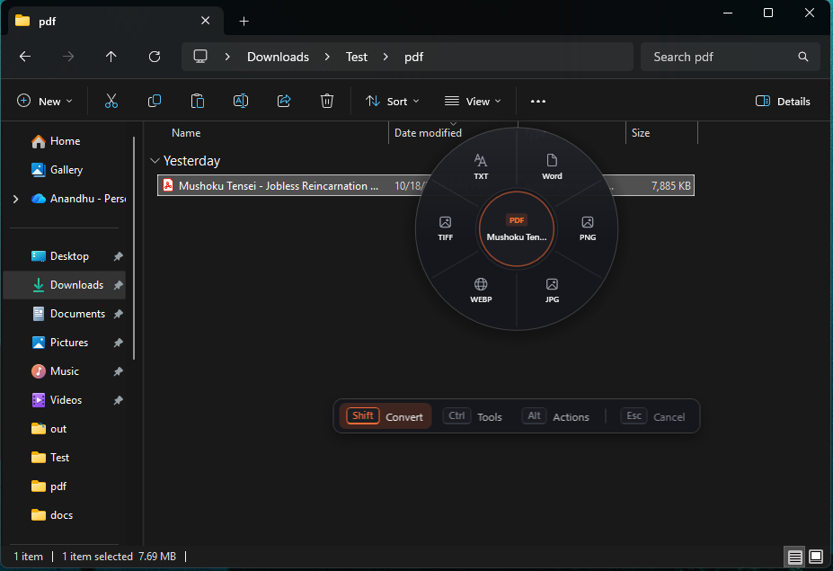
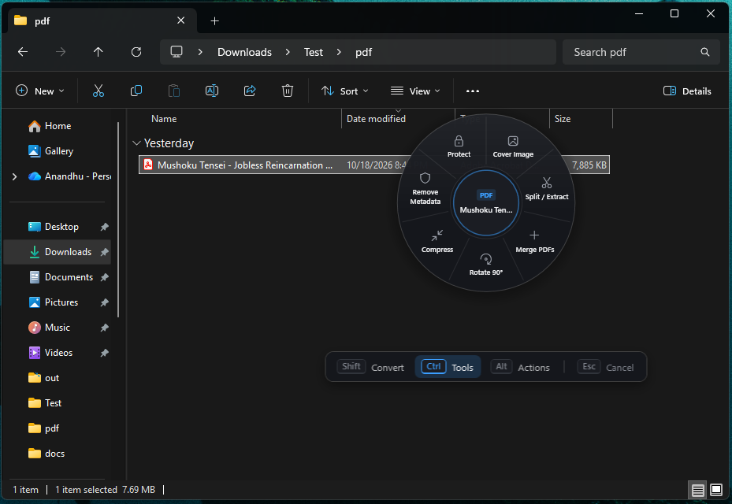
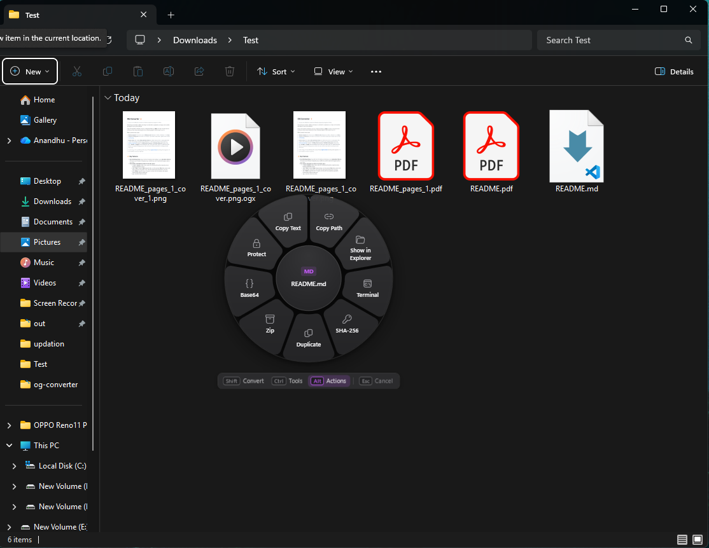
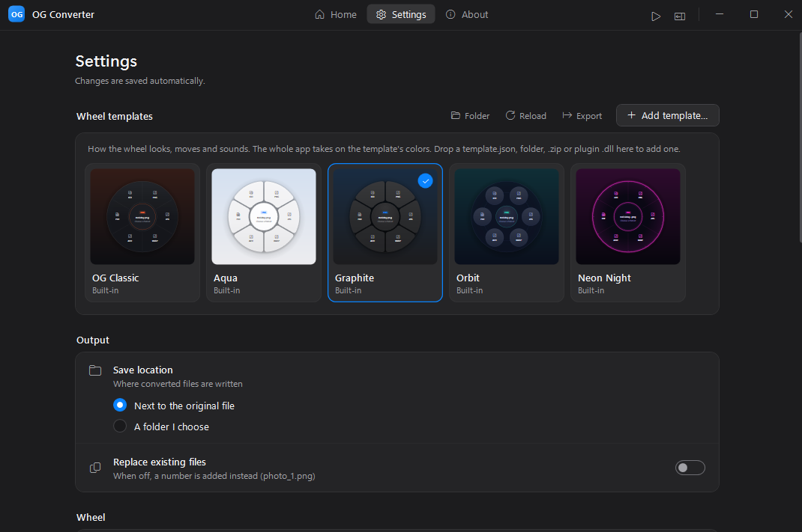

# OG Converter ⚡
> The zero-click offline file converter for Windows and Linux (beta) (inspired by Tangerine for Mac).

*Powered by pure boredom, caffeine, and living in a world with no superpowers, no magic, and no zombie apocalypse to save us from desk jobs.*

Drag a file anywhere in Windows (or in your Linux file manager), tap your configured hotkey (e.g. **Shift**), and drop. Turn files into the formats you need without breaking your flow. Everything happens 100% locally on your PC.

### 🎬 See it in action

**The wheel**: Convert, Tools and Actions, one key each.

https://github.com/user-attachments/assets/b6413b80-53fb-45b8-b197-93ae7aeeaf07

**Real conversions**: dragging everyday files and converting them without leaving Explorer.

https://github.com/user-attachments/assets/22a06ab1-d5d4-4027-9332-6b280cf2b70c



> **Platform support:** **Windows** 10 (1809+) / 11, and **Linux (beta)**, x64.
>
> 🐧 **The Linux version is a beta release.** Converting, Tools, Actions, the wheel, the dashboard and the dialogs all work.
> Custom templates still have some rough edges: templates that ship a renderer **plugin** (`.dll`) don't work on Linux yet
> (see [Linux (beta)](#-linux-beta) for the details). This will be sorted out soon.
> If you notice anything off, please **[report the bug](../../issues)**.

> **Project status:** this is **not a fully optimized release** yet. What it does aim for is staying light while it waits in the background.
> Measured on Windows 11 with the self-contained release build (see [Memory & startup](#-memory--startup) for details):
> **~64 MB private memory (~108 MB working set)** waiting in the tray, **~80 MB (~130 MB)** with the dashboard open.
> Heavy jobs (video, audio, GIF, WebP/AVIF/JPEG XL) run in a separate FFmpeg process, which uses extra memory only while
> it's working and exits when done.
>
> Found a bug, or hit any difficulty while using it? Please **[open an issue](../../issues)** describing what happened.
> I'll try to resolve it as soon as I get time.

---

## ✨ Key Features

- **Zero-Click Drag & Drop**: Drag a file from File Explorer, the Desktop or your **code editor's file tree** (VS Code, Cursor, Windsurf, Antigravity), tap a modifier key, and the radial wheel appears right at your cursor.
- **Three wheels, rebindable keys** (**Shift**, **Ctrl**, **Alt**, **Win**, **Space**):
  - `⇧ Shift`: **Convert**: images (incl. iPhone **HEIC** and **SVG**), video, audio, PDF, Word/Excel/PowerPoint, OpenDocument, Markdown/README, **web pages (HTML → PDF or a full-page picture)**, archives (ZIP, 7z, RAR, TAR, GZ…).
  - `Ctrl`: **Tools**: Compress, **Crop** (images & video, on a live preview), **Trim** (video, start to end), **Rotate**, **Extract Text (OCR)**, video **Snapshot**, resize, grayscale, remove EXIF, mute, 720p, PDF split/merge/rotate/protect, and more.
  - `Alt`: **Actions**: Copy Path, Show in Explorer, Terminal, SHA-256, Duplicate, **Archive** (ZIP, 7z, RAR, tar.gz, tar.zst, ISO…), Base64, Protect/Unlock, plus **Copy Image** / **Wallpaper** for pictures, **Copy Text** for text and code files, and **Unblock** for downloaded files. Work on folders too, which also get **Folder Icon**.
  - `Esc`: cancel the wheel at any time.
- **Batches**: drag several files at once and the option you pick runs on all of them, a few at a time so the PC stays responsive, with one progress notification, a summary at the end, and Cancel for one file or the whole batch (Windows; the Linux beta still takes one file per drag).
- **Lossless & lossy compression for every file type** (see below), including Google's **Guetzli** for smaller JPEGs.
- **Archive in 20+ formats**: ZIP, 7z, RAR, TAR, tar.gz/bz2/xz/zst/lz4/lz/br, single-file gz/bz2/xz/zst/lz4/lz/br, cpio, ISO and ar, each with its own settings (level, method, solid, multi-core, zstd long-range, Brotli window, RAR recovery record) and an optional password (see [Archive](#archive-actions--archive)).
- **Crop & Trim** with a preview window: draw the area to keep (free or locked to 1:1, 4:3, 16:9, 9:16…), or pick a video's start and end on a timeline with the first and last frames shown (see below).
- **README → PDF, PNG, Word, HTML, RTF or plain text**, with the screenshots it links to and GitHub-style layout.
- **Web pages → PDF or one full-page PNG/JPG** (saved `.html` and `.mht` pages), drawn by Edge exactly as on screen.
- **Extract Text (OCR)** from screenshots, photos of documents and scanned PDFs, with the OCR engine built into Windows. Copied, ready to paste.
- **Password protection**: PDF (AES-256), Office (Agile AES-256), encrypted `.ogx` files (AES-256-GCM / ChaCha20-Poly1305 + Argon2id), password-protected ZIP, 7z and RAR archives (7z/RAR can hide the file names too).
- **Wheel templates**: OG Classic, macOS-style **Aqua** and **Graphite**, Dock-style **Orbit** and synthwave **Neon Night**, each with its own shapes, animations and sounds. The whole app re-themes to match. Make your own with a `template.json` or a renderer plugin: see [docs/TEMPLATES.md](docs/TEMPLATES.md).
- **Settings**: output folder, wheel size (40–135%), close-on-key-release, sound feedback, overwrite behaviour, toasts, shortcut hint bar, reduce motion (see [Settings](#️-settings)).
- **Run portable or install**: the exe runs as-is; **Settings › System › Install** (or the banner on Home) installs it per-user (no admin), adds it to Start and Windows Settings › Apps, and can **start it with Windows** straight to the tray.
- **100% Offline & Private**: no uploads, no telemetry, no account.
- **System Tray**: sits quietly in the notification area (≈64 MB private memory when idle).

---

## ⌨️ Shortcuts

Start dragging a file in File Explorer, then tap a key while still holding the mouse button. The wheel opens at your cursor; drop on a slice to run it. Each key can be rebound on the Home screen.

**In a code editor** (VS Code, Cursor, Windsurf, Antigravity and other VS Code-based editors), press and hold on a file or folder in the editor's file tree and tap the key the same way. OG Converter reads the item under the cursor (or the selected one) from the editor's accessibility tree, so it works even before the drag starts. Other editors work by dragging the file onto the wheel.

### `Shift`: Convert
Change the file's format. For a PDF: Word, PNG, JPG, WebP, TIFF, or plain text.



### `Ctrl`: Tools
Edit or optimize the file. For a PDF: Compress, Split / Extract, Merge, Rotate, Cover Image, Remove Metadata, Protect. For an image: Compress, Crop, Half Size, Grayscale, Remove EXIF. For a video: Compress, Trim, Crop, Mute, 720p, First 10s.



### `Alt`: Actions
Quick file actions: Copy Path, Show in Explorer, Terminal, SHA-256, Duplicate, Archive, Base64, Protect. SHA-256 copies the checksum to the clipboard and shows it in Recent activity (hover for the full value).



Press `Esc` at any time to close the wheel.

The bar under the wheel lists these keys. It shrinks with the wheel. It is hidden by default; turn it on in **Settings › Advanced › Shortcut hints under the wheel** while you learn the keys.

---

## 🗜️ Compression

Drag any file, open the **Tools** wheel (`Ctrl`), choose **Compress**. A dialog lets you pick **Lossless** or **Lossy**, start from a preset, and fine-tune everything. Your last choices are remembered for each file type, and a live summary shows exactly what will happen. If a setting can't make the file smaller, nothing is written and you're told why.

| File type | Lossless | Lossy |
|---|---|---|
| **JPEG** | Metadata removed (GPS, camera, XMP); image data byte-for-byte identical; orientation preserved | JPEG / WebP / AVIF / JPEG XL with quality slider, resize, EXIF rotation applied |
| **PNG** | Optimized PNG (max zlib, adaptive filters), WebP lossless, JPEG XL lossless | **Palette PNG like TinyPNG/pngquant** (dithered, 16–256 colors), WebP, AVIF, JPEG XL, JPEG |
| **BMP / TIFF / WebP / AVIF** | PNG, Deflate TIFF, WebP lossless, JPEG XL lossless | WebP, AVIF, JPEG XL, JPEG, resize |
| **GIF** | Animated WebP (lossless) | Optimized palette, fewer colors, frame-rate cap, resize, or animated WebP |
| **SVG** | Minify (comments, editor data, metadata removed) or `.svgz` | n/a |
| **Video** | Remux & clean (instant), FFV1 archival, H.264 / H.265 lossless | **H.264, H.265/HEVC, AV1 (SVT-AV1), VP9**; constant quality *or* **target file size (two-pass)**; resolution, frame rate, speed, audio; **GPU encoding** (NVIDIA NVENC, Intel Quick Sync, AMD AMF, auto-detected) |
| **Audio** | FLAC (level 12), Apple Lossless (ALAC), or tags/cover removed without re-encoding | **Opus**, AAC, MP3 (LAME VBR); bitrate, mono, sample rate |
| **PDF** | Streams re-compressed at max, uncompressed fonts/content deflated, thumbnails and unused objects removed | Images downsampled to a DPI (Screen 72 / eBook 150 / Print 300) and re-encoded, optional grayscale |
| **Word / Excel / PowerPoint, ODT / ODS / ODP** | Package re-zipped at max, PNG pictures optimized | Pictures resized like Office's *Compress Pictures* (Email 96 / Web 150 / Print 220 / HD 330 ppi) |
| **ZIP / TAR** | ZIP re-packed at maximum; TAR → `.tar.gz` / `.tar.br` | n/a |
| **Everything else** (text, logs, CSV, JSON…) | ZIP, GZip, **Brotli**; JSON minify (more formats: Actions › **Archive**) | n/a |

**Target file size**: in Lossy mode, choose **Size control › Target file size** and type a size (for example `1` for 1 MB, `0.5` for
500 KB) instead of guessing a quality. Works for images (every lossy format except Guetzli), GIFs, video, audio, PDFs and Office files:

- **Images, GIFs, PDFs, Office files**: OG Converter tries qualities from the best down and keeps the highest one that fits. Only when even
  a low quality is too big does it make the picture smaller (pictures in documents: lower resolution), as little as needed. A 7 MB PNG
  saved as a JPEG under 1 MB keeps its full size and gets the best JPEG quality that fits.
- **Audio**: the highest bitrate that fits the length of the track (MP3 at a constant bitrate), checked after encoding.
- **Video**: the bitrate for the size, encoded in two passes (as before).

The limit counts 1 MB as 1,000,000 bytes, so the file is under it whether a site counts megabytes the Windows or the Linux way. If a
file can't get that small at all, the smallest result is kept and marked *Smallest possible, over target* in Recent activity.

**Presets** include *Under 2 MB*, *Under 1 MB* and *Under 500 KB* for images, PDFs and Office files, *Discord 10 MB*, *WhatsApp 16 MB*
and *Email 25 MB* for video, *Voice/podcast* for audio, and the classic PDF and Office resolution presets. Long jobs show a progress toast.

Notes:
- WebP, AVIF, JPEG XL, palette PNG, GIF, video and audio need **FFmpeg** (the full build includes every encoder used). JPEG, PNG-lossless, TIFF, PDF, Office and archive compression work without it.
- JPEG XL and AVIF give the smallest images but aren't supported by every app yet; the dialog tells you when that matters.
- **Guetzli** (Google's JPEG encoder) is offered as an output format: JPEGs 20–30% smaller that open everywhere. It's slow and memory-hungry (about 25 s and 250 MB per megapixel), so the dialog shows this PC's CPU and free memory, what the picture needs and how long it takes. A picture bigger than the free memory needs a smaller **Longest edge** or **Do it anyway**. The dialog downloads Guetzli (0.6 MB) when you first pick it.

### Archive (Actions › Archive)

Packs a file or folder in the format you pick, with that format's own settings. An optional password goes under **Advanced**.

| Format | Settings | Notes |
|---|---|---|
| **ZIP** | Level 0–9, Deflate or Store; AES-256 or ZipCrypto password | Opens everywhere |
| **7z** | Level 0–9; LZMA2, LZMA, PPMd, BZip2, Deflate or Store; solid; all cores; AES-256 password, file names hidden | Built in through Windows' `tar.exe`; **7-Zip** is used when installed and is needed for 7z passwords |
| **RAR** | Level 0–5, solid, recovery record (1–10%), all cores; AES-256 password, file names hidden | Needs **WinRAR** (shareware) to create |
| **TAR**, **tar.gz**, **tar.bz2**, **tar.xz**, **tar.zst**, **tar.lz4**, **tar.lz**, **tar.br** | Each codec's own levels (zstd 1–22 with long-range matching, Brotli 0–11 with window size, xz/zstd on all cores…) | Keep folders and dates for Linux and macOS |
| **gz**, **bz2**, **xz**, **zst**, **lz4**, **lz**, **br** | Same levels, for one file (`report.pdf` → `report.pdf.zst`) | |
| **cpio**, **ISO** (ISO 9660 + Joliet), **ar** | n/a | ISO images mount in Windows with a double-click |

- **Quick picks**: chips for ZIP, 7z, tar.gz, tar.zst, tar.xz and RAR; every format is in the list below them. Folders only see formats that can hold a folder.
- **Password (Advanced)**: ZIP (AES-256 or ZipCrypto), 7z and RAR (AES-256, optionally hiding the file names). Formats that can't
  hold a password say so. The password is never saved; the other choices are remembered for next time.
- **Pictures inside**: packed unchanged, optimized losslessly (JPEG metadata removed, PNGs re-encoded), or re-encoded with **Guetzli**
  (20–30% smaller JPEGs, no visible difference). Pictures are re-encoded in a temporary copy, so your originals don't change.
- **Guetzli resources panel**, like LM Studio's model settings: this PC's CPU, threads and free memory, a memory bar
  (green / amber / red), the estimated time, and **Parallel jobs** (Auto, 1, 2, 4…, one CPU core each), each choice showing
  its time and memory. Auto runs as many as the free memory allows. Pictures bigger than the free memory are packed unchanged
  unless you tick **Do it anyway** (Windows then uses the page file, which is slower). No admin rights are needed: Windows gives
  apps all the memory it has. One picture always uses one core; parallel jobs speed up folders of photos.
- **Progress**: long jobs show progress in Recent activity and a toast. Quitting OG Converter stops any Guetzli, 7-Zip or WinRAR still running.
- **Helpers**: when a choice needs 7-Zip, WinRAR or Guetzli, the dialog shows an **Install** / **Download** button for it.
- Every format can be extracted again from the Convert wheel (**Extract**).

### Password-protected archives (Actions › Protect)

For any file or folder, **Protect › Password-protected archive** makes a ZIP, 7z or RAR with:

- **Archive format**: ZIP (opens everywhere), 7z (AES-256, usually the smallest) or RAR (AES-256, made with WinRAR).
- **Encryption** for ZIP: AES-256 (recommended) or ZipCrypto (opens in Windows Explorer, but weak).
- **Encrypt file names too** for 7z and RAR, so not even the list of contents is visible without the password.
- **Compression**: Store, Normal or Maximum.

**Unlock** (Actions wheel) opens password-protected ZIP, 7z and RAR files, checks the password, and extracts them next to the original.

---

### Folder icons (Actions › Folder Icon)

Drag a folder (or several), tap `Alt` and pick **Folder Icon**: choose one of 10 colours and 32 symbols (work, code, music, photos,
games, travel…) with a live preview, or **Use a picture…** of your own. **Apply** changes the icon right away; **Reset to default**
brings back the standard folder.

- The icon is saved inside the folder as a hidden `.folder-icon.ico` (Windows) or `.folder-icon.png` (Linux), so it goes wherever the
  folder goes: moved, copied to a USB stick or zipped.
- **Windows** sets it the same way as Properties › Customize › Change Icon (`desktop.ini`), with the icon named relative to the folder.
  Folders where you can't write (system folders, some network shares) can't get one.
- **Linux** sets it with `gio` (GNOME Files, Nemo, Caja). The file manager remembers the icon by path, so after moving the folder set
  it again.

## ✂️ Crop & Trim

**Crop** (Tools wheel, images and videos) opens a window with the picture, or a frame of the video:
- Drag the handles to resize the area, drag inside it to move it, or draw a new one. Arrow keys nudge it (Shift = 10 px), **Enter** crops.
- Lock the shape to **Free, Original, Square, 4:3, 3:2, 16:9, 4:5 or 9:16**. The exact pixel size is shown live; **Reset** selects everything again.
- Videos have a slider to choose which frame to preview. The sound is kept as it is; width and height are rounded to even numbers, as video encoding requires.
- Saved next to the original as `name_cropped.ext`, in the same format. Phone photos are cropped the right way up and JPEGs keep their camera details. Animated GIFs keep every frame.

**Trim** (Tools wheel, videos) keeps only the part between a start and an end:
- Drag the two handles on the timeline, slide the whole selection, or type times like `1:05`, `65.5` or `1:02:03`. The first and last frames you'll keep are shown side by side.
- **Exact** (default): cut to the frame, re-encoded. **Fast cut**: instant and original quality, but it snaps to the nearest keyframe, so the clip may start a little early.
- Saved as `name_trim_1m05s-1m30s.mp4`.

Both need **FFmpeg** for video. Image crop works without it, except saving WebP/AVIF in their own format (they're saved as PNG instead).

---

## 📝 Markdown & README files

Drag a `README.md` (or any `.md`) and tap **Shift**:

| Output | How |
|---|---|
| **PDF** | Printed by Microsoft Edge (built into Windows; Chrome works too), so code blocks, tables, task lists, note boxes and images look like GitHub. Falls back to Word or LibreOffice. |
| **DOCX / ODT / RTF** | Through Word or LibreOffice |
| **HTML** | A standalone page with the same styling |
| **TXT** | Plain text with the Markdown symbols removed |

| **PNG** | The whole rendered README as one tall picture (for sharing in chats or docs) |

Pictures linked with relative paths (`` or ``) are included wherever the output is saved, and are embedded in Word/RTF files so they still show on other PCs.
Pictures on the internet (build badges) are waited for up to 20 seconds; on an offline PC the PDF is made without them instead of failing.

---

## 🧰 Everyday extras

| File | Wheel | What you get |
|---|---|---|
| **Web page** (`.html`, `.mht`) | Convert | **PDF** (printed by Edge), **PNG/JPG** of the whole page top to bottom, plus Word/RTF/TXT for `.html` |
| **SVG** | Convert | PNG (transparent, at 2× for sharp icons), JPG, ICO, WebP…, or a **vector PDF** |
| **HEIC / HEIF** (iPhone photos) | Convert | JPG, PNG, PDF, WebP… the right way up. Uses the free [HEIF Image Extensions](https://apps.microsoft.com/detail/9pmmsr1cgpwg) from the Microsoft Store, or FFmpeg |
| **Several pictures** | Convert › **PDF** | Asks first: **one PDF** with a page per picture (sorted by name; reorder or remove in the list), saved as `first_merged.pdf`, or **one PDF per picture** |
| **Picture** | Tools › **Extract Text** | The text in it (OCR), saved as `name_text.txt` and copied |
| **Scanned PDF** | Convert › TXT | Pages that are only pictures are read with OCR automatically |
| **Picture / video** | Tools › **Rotate 90°** | Turned clockwise. Photos keep their format and camera details; videos keep their sound |
| **Video** | Tools › **Snapshot** | The frame from the middle of the video as a PNG |
| **Archive** (ZIP, 7z, RAR, TAR, TAR.GZ/BZ2/XZ/ZST/LZ4/LZ/BR, GZ, BZ2, XZ, ZST, LZ4, LZ, BR, CPIO, ISO, CAB) | Convert | **Extract**, or re-pack as ZIP, TAR or TAR.GZ |
| **Picture** | Actions › **Copy Image** | The picture on the clipboard: paste it straight into WhatsApp, Teams, mail or Word |
| **Picture** | Actions › **Wallpaper** | Sets it as the desktop background |
| **Text or code file** | Actions › **Copy Text** | The whole file's contents on the clipboard |
| **Downloaded file** | Actions › **Unblock** | Removes Windows' "came from the internet" block (Protected View, SmartScreen warnings, blocked macros), like *Properties › Unblock*. Only shown for blocked files |

OCR reads the languages installed in Windows (**Settings › Time & language › Language & region**). 7z and RAR (including password-protected ones, through **Unlock**) are read in-process; CPIO, ISO and CAB use the `tar.exe` built into Windows 10 1803+.

---

## 🎨 Wheel Templates

A template sets how the wheel **looks, moves and sounds**, and the whole app (Home, Settings, dialogs, notifications) switches to its colors with it.

| Template | Style | Motion & sound |
|---|---|---|
| **OG Classic** | The original graphite ring | Pop, crisp clicks |
| **Aqua** | macOS light: frosted rounded tiles, system blue / orange / purple | Spring, glassy taps |
| **Graphite** | macOS dark mode | Spring, glassy taps |
| **Orbit** | Dock-style bubbles that magnify under the cursor | Bloom, bubbly bloops |
| **Neon Night** | Synthwave HUD: glowing outlines, tick marks, mono labels | Spin, synth blips |

- **Switch** in **Settings › Wheel templates** (hover a card to preview its animation) or with the template picker on **Home**.
- **Add community templates** with **Add template…**: pick a `template.json`, a `.zip` / `.ogtemplate` package or a plugin `.dll`, or drag one onto the gallery. They're stored in `%AppData%\OGConverter\Templates`.
- **Make your own**: a `template.json` needs no code (colors, shape, animation, sound pack or your own `.wav` files). A **renderer plugin** (`IWheelRenderer`) can draw a completely new wheel. **Export** saves the active template as a starting point.
- **Samples**: [`samples/templates/sunset/template.json`](samples/templates/sunset/template.json) (no code) and [`samples/WheelPluginSample`](samples/WheelPluginSample) (a plugin; build it, then add `WheelPluginSample.dll` from its `bin\Release\...` folder).

- **Step-by-step guide** (every setting, sounds, animations, writing a plugin): **[docs/PLUGIN_GUIDE.md](docs/PLUGIN_GUIDE.md)**
- **Quick reference**: **[docs/TEMPLATES.md](docs/TEMPLATES.md)**

> Plugins are programs and run with the same access as OG Converter. The app asks before adding one; only install plugins from people you trust.

> 🐧 **On Linux (beta):** the five built-in templates and `template.json` / `.ogtemplate` templates without a plugin work the same as on Windows.
> Renderer **plugins** (`.dll`) are Windows only for now: they're built on WPF, and the Linux app can't load plugins yet, so a template that
> ships one is drawn with the classic ring instead. Plugin support on Linux is being worked on and will be sorted out soon.

---

## ⚙️ Settings

Open the dashboard from the tray or taskbar and pick **Settings**. Changes are saved automatically (to `%AppData%\OGConverter`).



| Section | Setting | What it does |
|---|---|---|
| **Wheel templates** | Template gallery | Pick OG Classic, Aqua, Graphite, Orbit or Neon Night (or a community one). **Add template…**, **Folder**, **Reload** and **Export** manage your own; you can also drop a `template.json`, folder, `.zip` or plugin `.dll` on the gallery |
| **Output** | Save location | **Next to the original file**, or **a folder I choose** |
| | Replace existing files | When off, a number is added instead (`photo_1.png`) |
| **Wheel** | Size | 40–135%. Small wheels show short labels or icons only |
| | Close when the shortcut key is released | On: hold the key while you choose; letting go cancels. Off: the wheel stays open until you drop the file or press `Esc` |
| | Sound feedback | A soft tick when moving between options and switching wheels |
| **Notifications** | Show a notification when done | A small card in the corner with **Open** and the result size |
| **System** | Install / Uninstall | Per-user install, no admin rights (see [Install, start with Windows, uninstall](#install-start-with-windows-uninstall)) |
| | Start with Windows | Opens quietly in the tray when you sign in |
| | Check for updates | Finds the latest release, shows what's new, then downloads, verifies and restarts. Only contacts GitHub when you click |
| **Advanced** | Shortcut hints under the wheel | Show the `Shift · Ctrl · Alt · Esc` bar under the wheel (off by default) |
| | Reduce motion | Show the wheel instantly, without open, switch and hover animations |
| **Engine** | FFmpeg, Office documents, Browser, PDF | Shows **Ready** or **Not found** for each engine and which path or app it uses, with **Install** buttons for FFmpeg and LibreOffice |

The shortcut keys themselves are rebound on the **Home** screen.

---

## 📊 Memory & startup

Measured on Windows 11 with the self-contained release build (`dotnet publish` command below):

| State | Private memory | Working set | CPU |
|---|---|---|---|
| **Started with Windows**, waiting in the tray (`--background`) | ~64 MB | ~108 MB | ~0.6 s to start, then effectively idle |
| **Dashboard open** | ~80 MB | ~130 MB | window shown in ~0.55 s |
| After a session of conversions and dialogs | ~110 MB | ~180 MB | idle |

- **Private memory** is what OG Converter alone uses. The working set also counts shared Windows and .NET libraries, which other apps use too.
- In the tray, the keyboard and mouse hooks only wake the app for its own keys. Mouse movement is ignored until the wheel is open.
- Converting, crop previews and trimming start FFmpeg, Edge or Office as separate processes, which exit when done.
- In a VS Code-based editor, the first lookup turns on the editor's accessibility support, which can make the *editor* use a little more memory.

---

## 🚀 How to Run

### Download
**Windows:** grab `og-converter-vX.Y.Z-win-x64.exe` from [Releases](../../releases) and run it: no installer or .NET runtime needed.
It runs portable; to install it, see [Install, start with Windows, uninstall](#install-start-with-windows-uninstall) below.

**Linux (beta):** grab `og-converter-vX.Y.Z-linux-x64.tar.gz`; see [Linux (beta)](#-linux-beta) below.

### Requirements
**To use the app:** Windows 10 (1809) or later. That's all: the exe starts and converts PDFs, JPEG/PNG/TIFF/BMP, text, Markdown and archives on its own.

The tools below are **optional**. OG Converter looks for each tool on your PC and, when one is missing, leaves out the options that need it
or shows a hint telling you what to install. It **never installs anything on its own**: on first start (and right after **Install**) it offers
to install a missing FFmpeg, and LibreOffice when neither Microsoft Office nor LibreOffice is found, through winget, only if you click Install.
The same **Install** buttons are in **Settings › Engine**. The browser is only reported there.

| Optional tool | Unlocks | If it's missing |
|---|---|---|
| [FFmpeg](https://ffmpeg.org/): `winget install Gyan.FFmpeg` (the full build) | Video, audio, GIF, WebP, AVIF, JPEG XL and palette-PNG conversion and compression; video crop and trim | Those conversions stop with a hint to install it |
| Microsoft Office, or LibreOffice (`winget install TheDocumentFoundation.LibreOffice`) | Word, Excel, PowerPoint and OpenDocument conversions | Those conversions stop with a hint to install one |
| Microsoft Edge (ships with Windows; Chrome, Brave or Vivaldi work too) | Markdown → PDF/PNG, web page → PDF/PNG/JPG, SVG conversions | Markdown and `.html` → PDF fall back to Word or LibreOffice; the **PNG/JPG** options for web pages and Markdown, and **PDF** for `.mht`, aren't shown; SVG conversions stop with a message |
| [HEIF Image Extensions](https://apps.microsoft.com/detail/9pmmsr1cgpwg) (free, Microsoft Store) | HEIC/HEIF photos (iPhone) | FFmpeg is used instead; with neither, HEIC conversions stop with a hint |
| An OCR language in **Settings › Time & language › Language & region** | Copy Text from pictures and scanned PDFs | Copy Text stops with a hint to add one |
| [7-Zip](https://www.7-zip.org/) (`winget install 7zip.7zip`) | Password-protected 7z; every 7z method on older Windows 10 | The Archive and Protect dialogs offer to install it |
| [WinRAR](https://www.win-rar.com/) (`winget install RARLab.WinRAR`, shareware) | Creating RAR archives | The Archive and Protect dialogs offer to install it; opening RAR doesn't need it |
| [Guetzli](https://github.com/google/guetzli) (downloaded on request to `%LocalAppData%\OGConverter\tools`, SHA-256 checked) | Guetzli JPEG re-encoding in Compress and Archive | The dialog offers a Download button |

**Where FFmpeg is looked for**, in order: next to `og-converter.exe`, every folder on `PATH`, `%LocalAppData%\Microsoft\WinGet\Links`,
`C:\ffmpeg\bin` and `C:\Program Files\ffmpeg\bin`. FFmpeg is detected **once, when OG Converter starts**, so after installing it,
quit OG Converter from the tray and start it again.

**Where 7-Zip, WinRAR and Guetzli are looked for**, every time they're needed (no restart after installing): next to `og-converter.exe`,
`%LocalAppData%\OGConverter\tools`, `Program Files` (`7-Zip\7z.exe`, `WinRAR\Rar.exe`) and every folder on `PATH`.

**Checking what was found:** **Settings › Engine** shows **Ready** or **Not found** for **FFmpeg** (with the path it found), the
**Office documents** engine (with which of Office/LibreOffice it uses) and the web browser. Edge, the HEIF extension and OCR aren't
listed there; you'll see their options missing, or a message when you convert. 7-Zip, WinRAR and Guetzli are reported in the Archive,
Protect and Compress dialogs when a choice needs them.

**To build from source:** the [.NET 10 SDK](https://dotnet.microsoft.com/) as well.

### Run in Development
```powershell
# From the repository root
dotnet run --project src\OgConverter.Windows
```

### Install, start with Windows, uninstall
The downloaded exe runs without installing. To install, use **Settings › System › Install** (or the banner on Home): it copies OG Converter to
`%LocalAppData%\Programs\OG Converter` (fixed; it can't be changed. To keep it somewhere else, skip installing and run the exe from any folder you like), adds a Start menu entry and an entry in Windows Settings › Apps, and turns on **Start with Windows**
(starts in the tray via `og-converter.exe --background`; toggle it in Settings › System). Uninstall from Settings › System or Windows Settings › Apps;
settings and templates in `%AppData%\OGConverter` are kept.

### Run the Self-Test Suite
```powershell
dotnet run --project src\OgConverter.Windows -- --test
```
Covers conversions, PDF tools, protection, and compression for every file type and mode: lossless results are checked pixel-for-pixel, target sizes are measured, and PDFs and Office files are validated after compression.
It also crops every image format, animated GIFs and video, trims video (exact and fast), reads paths from every kind of drag source (Explorer, editor path text, `file://` links),
and converts a README with screenshots to every Markdown output, checking the pictures made it into the PDF and are embedded in the DOCX.
It renders web pages, SVG and HEIC photos, reads text with OCR (including a scanned PDF), rotates pictures and video, extracts and re-packs 7z/TAR/GZ/BZ2/XZ archives,
and checks Copy Text, Copy Image and Unblock.
The archive section packs a folder and a file in **every** Archive format, extracts each one and compares the contents byte for byte
(Windows' own `tar.exe` must also read them), checks that levels and options change the result, password ZIP/7z/RAR round-trips,
refused choices (gz on a folder, a password on tar.gz), lossless and Guetzli picture re-encoding (including the parallel and
too-big cases) and the Guetzli planner. Parts that need 7-Zip, WinRAR or Guetzli are skipped, with a note, when they aren't installed.
It also checks wheel templates: every built-in renders in every wheel at 40% and 100%, imports are validated and sandboxed, and bad files are rejected
(against a temporary templates folder, never your own). To include the plugin checks, build the sample plugin and point `OGCONVERTER_PLUGIN_SAMPLE` at it:

```powershell
dotnet build samples\WheelPluginSample -c Release
$env:OGCONVERTER_PLUGIN_SAMPLE = "$PWD\samples\WheelPluginSample\bin\Release\net10.0-windows10.0.19041.0\WheelPluginSample.dll"
dotnet run --project src\OgConverter.Windows -- --test
```

`--test markdown,everyday,archive,protection` runs only those sections: `markdown` (README outputs), `everyday` (web pages, SVG, HEIC, OCR,
rotate/snapshot, archive extraction and the newer actions), `archive` (the Archive action and Guetzli) and `protection` (every Protect
method, including password 7z/RAR, and Unlock).

`dotnet run --project src\OgConverter.Windows -- --snapshot <folder>` renders every screen, dialog and installed template to PNG for visual review.

### Convert from the command line
```powershell
og-converter.exe --convert README.md pdf              # any Convert option, by format
og-converter.exe --convert photo.heic jpg --out D:\out  # into another folder
og-converter.exe --convert clip.mp4 tool_snapshot      # Tools options by id
og-converter.exe --convert report.html                 # list what this file can do
```
Uses your saved settings (output folder, overwrite). Exit code 0 on success, 1 on failure, 2 for a bad choice.

### Publish a Release Build (single self-contained `.exe`)
```powershell
dotnet publish src\OgConverter.Windows\OgConverter.Windows.csproj -c Release -r win-x64 --self-contained -p:PublishSingleFile=true -p:IncludeNativeLibrariesForSelfExtract=true -o publish
```
Output: `publish\og-converter.exe` (≈174 MB, no .NET install needed). It's the same command the release workflow runs; add `-p:Version=1.2.3` to stamp a version
(shown in Settings › System and Windows Settings › Apps). Name the Windows `.csproj` explicitly: `og-converter.sln` also holds the portable
`OgConverter.Core` library, and the sample plugin under `samples/` is a separate project.
There's no separate installer: the exe installs itself from **Settings › System › Install**.

To cut a release, add a `## [1.2.3]` section to [CHANGELOG.md](CHANGELOG.md) describing what changed, then push the tag `v1.2.3`.
The workflow stamps the version (shown in About), publishes the exe, and uses that section as the release's **What's new**, which users see in
**Settings › System › Check for updates** before updating in place.

Adding `-p:EnableCompressionInSingleFile=true` shrinks the exe to ≈74 MB, but it then uses ≈60 MB more RAM at runtime
(assemblies are decompressed into memory), so the release build ships uncompressed.

The Linux build (works from Windows too):
```bash
dotnet publish src/OgConverter.Linux/OgConverter.Linux.csproj -c Release -r linux-x64 --self-contained -p:PublishSingleFile=true -p:IncludeNativeLibrariesForSelfExtract=true -o publish/linux
```
Output: `publish/linux/og-converter` (≈110 MB). Copy it to a Linux machine with `scp` or a USB stick; VM drag-and-drop and shared
clipboards often cut large files short, which makes the program crash on start (compare `sha256sum` if in doubt).

---

## 🐧 Linux (beta)

The Linux version runs the same engine as the Windows one (`OgConverter.Core`) with its own Avalonia UI. It's a **beta**: everything
below works, but expect some rough edges. Tested on Ubuntu 26.04 with GNOME 50 on Wayland.

**What works:** the Convert, Tools and Actions wheels, the dashboard (Home, Settings, About, history), every dialog (Compress, Archive,
Protect/Unlock, PDF split/merge, Crop, Trim), notifications, the tray icon, sounds, the five built-in templates, `template.json` and
`.ogtemplate` templates, `--convert`, `--test` and `--snapshot`.

**Current limitations** (being worked on, and will be sorted out soon):
- **Custom templates with a renderer plugin (`.dll`)** don't work yet. Plugins are built on WPF, which only runs on Windows, and the
  Linux app can't load plugins at all yet; such templates are drawn with the classic ring.
- **Drag-and-tap needs GNOME Shell 50** (through a small helper extension, see below). On other desktops, open the wheel from the file
  manager's right-click menu (Files, Dolphin, Nemo) or with `og-converter --wheel <file>`.
- **Updates**: the Linux download isn't an AppImage yet, so **Check for updates** shows what's new and links to the release page instead
  of updating in place.
- **Press and tap without moving (GNOME)**: pressing a file and tapping the key before the mouse moves opens an empty wheel; the
  options appear as soon as you move the mouse (Files only starts the drag after a few pixels). Dragging first, then tapping, works
  normally. On Windows both work.
- **Title bar**: the main window still has the desktop's own title bar above the app's header. On Windows the app draws a single bar
  with its own buttons; on Linux that's planned for a later release.
- Microsoft Office, winget, Windows OCR and Unblock are Windows features; on Linux, LibreOffice handles Office files and Tesseract reads text.

Found a bug, or something that works differently from Windows? Please **[open an issue](../../issues)** and mention your distribution and desktop.

### Install and run
```bash
tar -xzf og-converter-vX.Y.Z-linux-x64.tar.gz
chmod +x og-converter
./og-converter
```
Then, in the dashboard:
1. **Settings › System › Install** copies it to `~/.local/share/og-converter`, adds it to your app menu and `~/.local/bin`, and starts it
   in the tray when you log in (no root needed).
2. **Settings › Desktop integration › Install** sets up the GNOME helper extension. GNOME only loads extensions when you log in, so
   **log out and back in once**. The same page adds **OG Converter** to the file managers' right-click menus.

GNOME on Wayland doesn't let apps see keys while you drag, so the extension watches for the key tap during a drag and tells
OG Converter over D-Bus. It runs only while OG Converter is running; see [`linux/gnome-extension`](linux/gnome-extension).

### Requirements
**To use the app:** a 64-bit Linux desktop (glibc). Like on Windows, the tools below are optional: missing ones leave out the options
that need them, and **Settings › Engine** shows the install command for your package manager (apt, dnf, pacman or zypper).

```bash
# Ubuntu / Debian: everything in one go
sudo apt install ffmpeg libreoffice chromium tesseract-ocr tesseract-ocr-eng 7zip libarchive-tools wl-clipboard xclip poppler-utils libheif-examples
```

| Optional tool | Unlocks |
|---|---|
| FFmpeg | Video, audio, GIF, WebP, AVIF, JPEG XL; video crop and trim |
| LibreOffice | Word, Excel, PowerPoint and OpenDocument conversions |
| Chromium, Google Chrome or Microsoft Edge | Markdown → PDF/PNG, web page → PDF/PNG/JPG, SVG conversions (the Chromium snap works) |
| Tesseract (+ a language, e.g. `tesseract-ocr-eng`) | Extract Text / Copy Text from pictures and scanned PDFs |
| 7-Zip (`7z`), bsdtar (`libarchive-tools`) | Password 7z archives; CPIO, ISO and other tar formats |
| `wl-clipboard` / `xclip` | Copy Path, Copy Image, Copy Text, Base64 |
| `libheif-examples` | HEIC/HEIF photos (FFmpeg is used otherwise) |

Settings and templates live in `~/.config/OGConverter`.

---

## 🛠️ Architecture

```
OGConverter/
├── og-converter.sln
├── src/
│   ├── OgConverter.Core/             # Portable (plain .NET, no WPF or Windows APIs): everything that isn't UI
│   │   ├── Models/
│   │   │   └── Models.cs             # WheelItem, ConversionJob, AppSettings, Protection/Compression/Archive options
│   │   ├── Platform/                 # What each app plugs in at startup (Platform.cs): images, desktop, OCR, PDF pages, Office…
│   │   ├── Services/
│   │   │   ├── FormatRegistry.cs         # Which conversions, tools and actions each file type gets
│   │   │   ├── ConversionEngine.cs       # Runs a wheel choice: FFmpeg, native encoders, documents, tools
│   │   │   ├── CompressionService.cs     # Lossless/lossy compression for every file kind
│   │   │   ├── ImageCodec.cs             # Decode/encode through the image backend, EXIF orientation, lossless JPEG cleanup
│   │   │   ├── PdfCompressor.cs          # PDF image downsampling & stream optimization
│   │   │   ├── OfficeCompressor.cs       # DOCX/XLSX/PPTX/ODF picture compression & re-packing
│   │   │   ├── MediaToolkit.cs           # FFmpeg runner with progress, media probe, GPU encoder detection
│   │   │   ├── MediaEditService.cs       # Crop & Rotate (images, GIF, video), Trim, Snapshot, preview frames
│   │   │   ├── DocumentEngine.cs         # Office (through Platform.Office) / LibreOffice conversions, Markdown
│   │   │   ├── BrowserRenderService.cs   # Headless Edge/Chrome: HTML/Markdown/SVG → PDF or full-page PNG
│   │   │   ├── ArchiveService.cs         # Extract / re-pack every archive format (.NET, SharpCompress, Windows tar.exe)
│   │   │   ├── ArchiveWriter.cs          # Archive action: ZIP, 7z, RAR, tar.*, gz/bz2/xz/zst/lz4/lz/br, cpio, ISO, ar; Guetzli staging
│   │   │   ├── DependencyService.cs      # Optional helpers: FFmpeg, LibreOffice, 7-Zip, WinRAR (winget), Guetzli (download)
│   │   │   ├── GuetzliService.cs         # Guetzli encoding, PC specs, memory/time planner for parallel jobs
│   │   │   ├── UpdateService.cs          # Check for updates: latest GitHub release, checksum, restart
│   │   │   ├── OcrService.cs             # Text in pictures and scanned PDFs (engine: Platform.Ocr)
│   │   │   ├── PdfToolsService.cs        # Split, merge, rotate, metadata, text, PDF passwords
│   │   │   ├── PdfRenderService.cs       # PDF pages to images (renderer: Platform.Pdf)
│   │   │   ├── ProtectionService.cs      # Protect/Unlock routing; FileVault.cs (.ogx encryption)
│   │   │   ├── DroppedPaths.cs           # Paths from file:// links and path text dragged from editors
│   │   │   ├── TemplateManager.cs        # Built-in + community templates, import (renderers: Platform.WheelRenderers)
│   │   │   └── SettingsService.cs        # JSON settings in %AppData%\OGConverter
│   │   ├── CommandLine.cs            # --convert
│   │   └── Tests/                    # --test runner and its portable sections
│   ├── OgConverter.Windows/          # The WPF app (og-converter.exe)
│       ├── Platform/Windows/         # Windows side of Platform: WIC imaging, Windows.Media.Ocr, Windows.Data.Pdf, Office COM, …
│       ├── Controls/
│       │   ├── RadialWheelCanvas.cs      # Hosts a wheel: options, hover/open/switch animation, hands frames to the renderer
│       │   ├── CropCanvas.cs             # Crop preview: image, dimmed outside, handles, aspect lock
│       │   └── RangeTimeline.cs          # Trim timeline with start/end handles
│       ├── Wheel/
│       │   ├── WheelRenderApi.cs         # IWheelRenderer (the plugin adapter), WheelFrame, WheelPalette
│       │   ├── WheelPainter.cs           # Shared geometry, text, hub helpers for renderers
│       │   ├── WheelRendererHost.cs      # Built-in and plugin renderers, plugin loading
│       │   └── Renderers/                # Built-in renderers: Ring, Glass (macOS), Orbit (Dock), Neon
│       ├── Services/
│       │   ├── GlobalHookService.cs      # Low-level keyboard & mouse hooks for the drag gesture
│       │   ├── ShellSelectionService.cs  # Finds the file being dragged in Explorer
│       │   ├── IdeSelectionService.cs    # Finds the file in a VS Code-based editor's file tree (UI Automation)
│       │   ├── DroppedFiles.cs           # Reads paths from any drag source (file lists, file:// links, path text)
│       │   ├── WindowsShellService.cs    # Unblock downloads (Mark of the Web), desktop wallpaper
│       │   ├── SoundService.cs           # Synthesized sound packs per template (or a template's own .wav files)
│       │   ├── AppThemeService.cs        # Applies a template's palette to the whole app
│       │   ├── InstallService.cs         # Per-user install/uninstall, start with Windows
│       │   ├── TrayIconService.cs        # System tray icon
│       │   └── NotificationService.cs    # Result and progress toasts
│       ├── Views/
│       │   ├── RadialWheelOverlay.xaml   # Transparent, topmost radial menu
│       │   ├── CompressDialog.xaml       # Lossless/lossy compression options
│       │   ├── ArchiveDialog.xaml        # Archive format, level, method, pictures, password
│       │   ├── GuetzliResourcePanel.cs   # CPU / memory bar / time panel shared by Archive and Compress
│       │   ├── ExtrasDialog.xaml         # "Recommended extras" prompt (FFmpeg, LibreOffice)
│       │   ├── CropDialog / TrimDialog   # Crop on a preview; pick a video's start and end
│       │   ├── ProtectDialog / UnlockDialog / PdfSplitDialog / PdfMergeDialog
│       │   └── ToastNotificationWindow   # Completion & progress toasts
│       ├── MainWindow.xaml           # Home, Settings, About (+ MainWindow.Templates.cs, .System.cs, .Dependencies.cs, .Updates.cs)
│       └── Tests/                    # Self-test sections that need Office/WPF/Windows, and the --snapshot UI renderer
│   └── OgConverter.Linux/            # The Avalonia app for Linux (og-converter), beta: same layout as the Windows app
│       ├── Platform/Linux/           # Linux side of Platform: SkiaSharp imaging, PDFium, Tesseract OCR, wl-copy/xclip, xdg-open, …
│       ├── Services/                 # D-Bus trigger (DBusService), WheelController, install, GNOME extension, file-manager menus, tray
│       └── Wheel/, Views/, Controls/ # Ports of the Windows wheel, dialogs and controls (built-in renderers only, no plugins yet)
├── linux/gnome-extension/        # GNOME Shell helper: reports "key tapped during a drag" to the app over D-Bus
├── docs/
│   ├── PLUGIN_GUIDE.md           # Beginner's guide: templates, sounds, animations, writing a plugin
│   └── TEMPLATES.md              # Template & plugin quick reference
└── samples/                      # Sample template.json and a sample renderer plugin
```

---

## 🎯 Usage Guide

1. **Everyday flow**
   - In File Explorer, on your Desktop or in your code editor's file tree, start dragging any file.
   - While holding the mouse button, tap **Shift** (or your mapped key). The wheel appears at your cursor.
   - Move into a slice (you'll hear a tick) and release the mouse button.
   - The result is saved next to the original (or in your chosen output folder).

2. **Compressing**
   - Drag the file, tap **Ctrl**, drop on **Compress**.
   - Choose **Lossless** (identical quality) or **Lossy** (much smaller), pick a preset or fine-tune, then **Compress**.

3. **Archiving and protecting**
   - Drag a file or folder, tap **Alt**, drop on **Archive**. Pick a format, tune it, optionally add a password under **Advanced**, then **Create**.
   - For a password-protected copy, drop on **Protect** instead and choose **Password-protected archive** (ZIP, 7z or RAR) or another method.
   - To open a protected file again, drop it on **Unlock** and enter the password.

4. **Cropping and trimming**
   - Drag the image or video, tap **Ctrl**, drop on **Crop** (or **Trim** for a video).
   - Adjust the area or the start and end in the window that opens, then press **Enter**.

5. **Dashboard**
   - Open OG Converter from the tray or taskbar to see history, try the playground, rebind keys and change settings.
   - The ▶ button in the title bar previews the wheel in the middle of the screen.

6. **Make it yours**
   - **Settings › Wheel templates**: pick a template, or add one from the community.
   - **Settings › Wheel › Size**: 40–135%. Small wheels show short labels or icons only.
   - **Settings › Advanced**: hide the shortcut hint bar, or turn on **Reduce motion**.

7. **Install and start with Windows**
   - Click **Install** on the Home banner or in **Settings › System**. OG Converter then starts in the tray every time you sign in (toggle **Start with Windows** there).

---

## 🐧 Contributing

The **Linux version** is out as a **beta**. Help is very welcome with what's left: renderer plugins on Linux, drag-and-tap on desktops
other than GNOME (KDE, X11 sessions), AppImage packaging, and testing on other distributions. Open an issue or reach out through the
portfolio link below.

Bug reports, ideas and pull requests for both versions are welcome. See [CONTRIBUTING.md](CONTRIBUTING.md) for how to submit changes.

---

## 👨‍💻 Developers

- **Anandhu Suresh**: [Portfolio](https://dr-at0mic.github.io/) · [GitHub](https://github.com/Dr-At0mic)
- **Mahesh P S**: [GitHub](https://github.com/Yet-Zio)
- **Bijo Prasad**: [GitHub](https://github.com/hikigaya007)

---

## 📄 License

Licensed under the [GNU General Public License v3.0](LICENSE).

**Third-party components.** Bundled: [SharpZipLib](https://github.com/icsharpcode/SharpZipLib),
[SharpCompress](https://github.com/adamhathcock/sharpcompress), [ZstdSharp](https://github.com/oleg-st/ZstdSharp),
[K4os.Compression.LZ4](https://github.com/MiloszKrajewski/K4os.Compression.LZ4), [PDFsharp](https://github.com/empira/PDFsharp) 6.2.4 and
[Konscious Argon2](https://github.com/kmaragon/Konscious.Security.Cryptography) (MIT), [Markdig](https://github.com/xoofx/markdig) (BSD-2-Clause)
and [PdfPig](https://github.com/UglyToad/PdfPig) (Apache 2.0). Folder icon symbols: [Fluent UI System Icons](https://github.com/microsoft/fluentui-system-icons) (MIT). Installed or downloaded only when you ask:
FFmpeg (LGPL/GPL), LibreOffice (MPL), 7-Zip (LGPL), WinRAR (proprietary shareware) and Guetzli (Apache 2.0).
