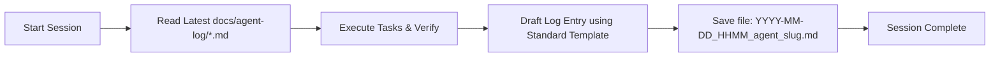

# og-converter Agent Logging Protocol (ALP)

> **Audience**: All AI Coding Agents (Google Antigravity, Claude Code, OpenAI Codex / ChatGPT, Cursor, Windsurf, GitHub Copilot CLI, etc.) and human developers.  
> **Purpose**: Maintain zero-context-loss continuity across multi-agent workflows and developer transitions.

---

## 1. Why We Log

When developing og-converter, work may be carried out across different AI tools and sessions (e.g., Claude Code for architecture, Antigravity for implementation, Cursor for rapid frontend tweaks). Without a standardized log:
- Context is lost between tool switches.
- Decisions made in chat windows vanish when sessions close.
- Next agents duplicate research or contradict earlier architectural decisions.

**Rule**: *Every agent must read the latest log before starting work, and write a new log before finishing its session.*

---

## 2. Standard Operating Procedure (SOP)



### When to Create a Log
1. **End of Conversation / Session**: Any conversation that generated plans, code, tests, or architectural decisions.
2. **Major Milestone Completion**: When completing a sprint task, scaffolding a new app, or concluding a refactor.
3. **Pre-Handoff**: When switching from one agent to another (e.g., "Switching to Claude Code for backend logic").

### File Naming Convention

```
docs/agent-log/YYYY-MM-DD_HHMM_<agent-name>_<kebab-case-topic>.md
```

- `YYYY-MM-DD`: UTC or local date (e.g., `2026-09-28`)
- `HHMM`: 24-hour time (e.g., `1430`)
- `<agent-name>`: Name of tool/agent (`antigravity`, `claudecode`, `codex`, `cursor`, etc.)
- `<kebab-case-topic>`: 2-4 words describing work done (e.g., `auth-scaffold`, `database-setup`, `ui-overhaul`)

*Example*: `2026-09-28_1430_antigravity_initial-setup.md`

---

## 3. Standard Log Template

Every log file **must** use the following structure:

````markdown
---
date: "YYYY-MM-DD HH:mm:ss"
agent: "antigravity | claudecode | codex | cursor | other"
model: "<Exact or human-readable model, e.g., Gemini 3.8 Flash, Claude 3.7 Sonnet, GPT-4o>"
session_type: "planning | scaffolding | feature | bugfix | refactor | documentation"
status: "completed | in_progress | blocked"
sprint: "Milestone / Sprint name (or N/A)"
related_files:
  - "path/to/key/file"
---

# Agent Session Log: <Title of the Session>

## 1. Context & Objectives
- **User Goal**: Brief statement of what the user asked for.
- **Starting State**: Where the repo was when this session began.

## 2. Actions Completed
- [x] Concrete task 1 with outcome
- [x] Concrete task 2 with outcome
- [x] Concrete task 3 with outcome

## 3. Files Created / Modified / Deleted
| Action | File Path | Description |
|---|---|---|
| `CREATED` | `path/to/file.ext` | Why it was created and what it contains |
| `MODIFIED` | `path/to/file.ext` | What changed and line areas affected |
| `DELETED` | `path/to/file.ext` | Why it was removed |

## 4. Key Decisions & Rationales
Record non-obvious choices, user answers, and trade-offs made:
- **Decision 1**: Description. *Rationale*: Why this was picked over alternatives.
- **User Preference**: Specific design or architecture choices requested by the user.

## 5. Verification & Testing
- **Build / Lint**: Command run and result (Pass/Fail/Not Run).
- **Automated Tests**: Test suite status (e.g., `14/14 tests passing`).
- **Manual Check**: Browser verification, API endpoint check, etc.
- **Output Notes**: Any warnings or environmental quirks observed.

## 6. Blockers & Open Questions
- None (or list active blockers requiring user input).

## 7. Next Agent Handoff (Action Items)
Specific instructions for the next agent picking up this repo:
1. **Next Task**: Exactly what to do next.
2. **Commands to Run**: Any startup/scaffolding commands needed.
3. **Watch Out For**: Any delicate areas or constraints to respect.
````

---

## 4. Rules for Agents (Strict Guidelines)

1. **Be Specific, Not Vague**: Do not write "updated files". Write "Added `UserEntity` to DB schema in `src/entities/user.entity.ts`".
2. **Always Link Files**: Use standard markdown links (e.g., `[filename](path/to/file)`).
3. **Capture User Decisions**: Whenever the user resolves an open question, log the exact decision under "Key Decisions & Rationales".
4. **Log Blockers Honestly**: If a build fails or an instruction was ambiguous, document it in Section 6 so the next agent doesn't repeat the error.
5. **No Placeholders in Logs**: Write concrete details; do not leave `<fill in>` markers in completed logs.
